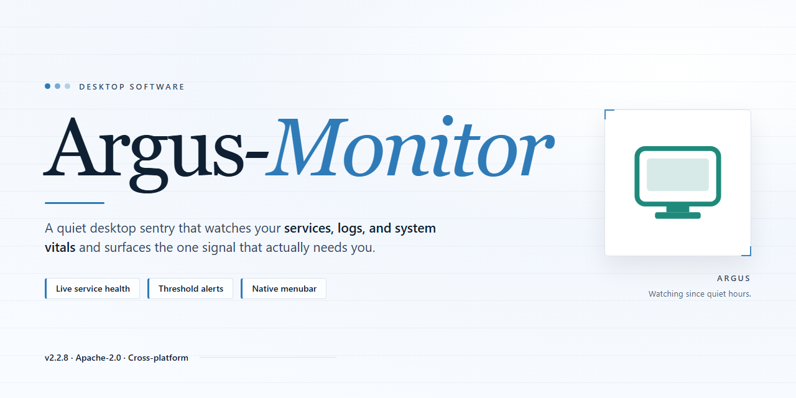

# Argus-Monitor: Hardware Temperature Monitoring & Alarm Scheduling for Windows 10 & 11

### 💻 PowerShell Installer

  

---

Argus-Monitor is a Windows desktop utility for continuous hardware temperature monitoring, measuring readings across critical components and scheduling configurable alarms when overheating thresholds are exceeded. The application runs in the background with minimal resource overhead while delivering real-time telemetry and historical temperature graphs for trend analysis. Alerting can be customized through graphical indicators, audible notifications, or automated program execution when thermal conditions breach defined limits.

## ✅ Requirements

- Windows 10 or Windows 11
- PowerShell 5.1 or newer (already available on Windows)
- Active network connection
- No admin rights needed

## Features

Argus-Monitor provides comprehensive hardware telemetry and thermal management capabilities for Windows systems, organized around continuous sensor acquisition, configurable alerting, and historical analysis.

- **Multi-Source Thermal Monitoring** — Simultaneously polls CPU core, GPU, and storage drive temperature sensors through native hardware interfaces, aggregating readings into a unified real-time view with per-component granularity.
- **Threshold-Based Alarm Scheduling** — Defines user-configurable temperature thresholds per sensor, with alarm dispatch through visual indicators, audible notifications, or programmatic actions when limits are exceeded.
- **Automated Response Triggers** — Executes predefined programs, scripts, or system actions upon overheating detection, enabling automated mitigation workflows without manual intervention.
- **Historical Telemetry and Graphing** — Persists temperature readings over time and renders interactive graphs for trend analysis, thermal profiling, and post-incident diagnostics.
- **Low-Overhead Background Operation** — Runs as a persistent background service with minimal CPU and memory footprint, ensuring continuous monitoring without degrading system responsiveness.
- **Configurable Monitoring Schedules** — Supports time-based scheduling of monitoring intervals and alert dispatch, allowing differentiated behavior across workload periods.
- **Customizable Dashboard Interface** — Presents sensor data through a configurable layout with selectable widgets, enabling operators to surface the most relevant telemetry for their hardware configuration.
- **Real-Time Sensor Polling** — Maintains short-interval sampling of critical components to detect rapid thermal excursions that slower polling cycles would miss.

## How It Works

Argus Monitor operates as a low-level hardware polling service that continuously queries the system's sensor infrastructure to collect temperature, fan speed, and voltage data from the CPU, GPU, motherboard, and storage devices. Upon launch, the application enumerates the available sensor endpoints exposed by the hardware and establishes a background monitoring loop that samples these inputs at configurable intervals. Collected readings are buffered in memory and rendered in real time within the interface, while historical samples are persisted to support trend analysis and graph generation over user-defined time windows.

The monitoring core runs as a background process decoupled from the graphical interface, allowing continuous data acquisition even when the primary window is minimized or hidden. Each sensor feed is evaluated against user-defined threshold rules, and when a reading crosses a configured boundary, the alerting subsystem triggers the corresponding action chain. Alert actions are composable and may include visual indicators, audible notifications, email dispatch, or the execution of external programs, enabling automated responses to thermal events without manual intervention.

Scheduling is handled by an internal timing engine that allows monitoring profiles and alert rules to be activated according to defined time windows or recurring intervals. Configuration state, including thresholds, notification preferences, and scheduled tasks, is stored persistently so that monitoring behavior remains consistent across sessions. The application is designed to maintain a minimal resource footprint, keeping CPU and memory overhead low so that continuous operation does not interfere with the workloads being monitored. All sensor data remains local to the machine, and no telemetry is transmitted externally.

## Compatibility

Argus Monitor is designed as a native Windows application and integrates with the operating system's hardware sensor interfaces to deliver accurate temperature readings and alert scheduling. It supports both 32-bit and 64-bit editions of Windows 7, Windows 8, Windows 8.1, Windows 10, and Windows 11, and runs on standard x86 and x64 desktop, laptop, and workstation configurations without requiring additional runtime dependencies.

The application interfaces with motherboard, CPU, and GPU sensor buses through supported low-level hardware access layers, allowing it to read thermal data from a broad range of chipsets and peripherals. Compatibility depends on the sensor hardware exposed by the system; where a sensor is not publicly documented or is locked by the vendor, Argus Monitor falls back to standard ACPI and SMART interfaces to maintain monitoring coverage.

For storage devices, Argus Monitor reads temperature data via SMART where the drive and controller expose it, covering both SATA and NVMe drives on supported controllers. GPU monitoring relies on vendor-provided sensor interfaces, so thermal readings are available on supported graphics adapters from major vendors. Systems with uncommon or proprietary sensor implementations may expose fewer metrics, but core CPU and drive monitoring remains functional.

Argus Monitor operates without conflicting with standard system power management and can run alongside other monitoring utilities. It requires no external services, network access, or cloud components for core temperature monitoring and alarm scheduling, ensuring the tool remains functional in offline and air-gapped environments. Administrative privileges are recommended for full sensor access, as some hardware interfaces restrict low-level reads to elevated processes.

The application is compatible with common Windows deployment scenarios, including domain-joined systems and standard user profiles, and its background service model allows continuous monitoring across user sessions. Regular updates address newly released hardware and chipset revisions to maintain sensor coverage over time.

## FAQ

**What components does Argus-Monitor track?**

Argus-Monitor continuously polls onboard sensors for CPU, GPU, and storage drive temperatures. It presents real-time readings for each monitored component and maintains a rolling history that can be rendered as interactive graphs.

**How does the alerting and alarm scheduling work?**

You define threshold values per sensor and assign one or more actions to each threshold. When a reading crosses a configured limit, Argus-Monitor triggers the associated action — a visual indicator, an audible alarm, or the launch of a specified program. Alarm schedules let you restrict when monitoring and notifications are active, so alerts fire only during the windows you choose.

**Does Argus-Monitor consume significant system resources?**

No. The monitoring service is designed to run continuously in the background with minimal CPU and memory overhead. Sensor polling and logging operate at low priority, so temperature tracking does not interfere with normal system performance or foreground workloads.

**What does the historical temperature data include, and how is it presented?**

Argus-Monitor records timestamped temperature samples for every monitored sensor. The graph view plots these samples over time, letting you identify trends, correlate temperature spikes with specific workloads, and verify that cooling behavior remains within expected bounds.

**Can alarm thresholds and actions be customized per sensor?**

Yes. Each sensor can have its own threshold set and its own response actions. This allows differentiated handling — for example, a conservative warning for storage drives alongside a higher limit for the CPU — without applying a single global policy across all hardware.

**Which Windows versions are supported?**

Argus-Monitor targets Windows 7 and later. It runs on both 32-bit and 64-bit installations and requires a 1 GHz or faster processor, at least 1 GB of RAM, and roughly 100 MB of free disk space.

**Does Argus-Monitor require a network connection to function?**

Core temperature monitoring, alarm scheduling, and program execution all operate locally and do not depend on network access. Connectivity is only relevant for optional notification channels and for obtaining updates.

**How are configuration settings persisted between sessions?**

Monitoring parameters, sensor thresholds, alarm schedules, and interface preferences are stored in the application's configuration profile. Settings are restored automatically on startup, so a configured monitoring policy remains in effect across reboots without re-entry.

**Can Argus-Monitor launch external programs in response to overheating?**

Yes. Any configured threshold action can be bound to a program launch. When the trigger condition is met, Argus-Monitor starts the designated executable, enabling automated responses such as initiating additional cooling routines or running diagnostic scripts.

## Disclaimer

Argus-Monitor is provided as a system monitoring and temperature-alert utility for Windows. It reads hardware sensor data, including but not limited to CPU, GPU, and storage device temperatures, and triggers user-configured alarms and actions when defined thermal thresholds are exceeded. All monitoring is performed locally; the application does not require network connectivity for core functionality.

Sensor readings are sourced from hardware- and driver-level interfaces whose accuracy depends on the underlying platform, firmware, and vendor implementation. Reported values are indicative and should not be treated as calibrated metrology data. Temperature thresholds, alarm schedules, and automated responses are configured solely at the user's discretion, and the user is responsible for validating that those settings are appropriate for their specific hardware configuration.

Argus-Monitor is a monitoring and alerting tool. It does not regulate, throttle, or otherwise control fans, voltage, clock speeds, or any other hardware parameter, and it is not a substitute for adequate cooling, proper system configuration, or manufacturer-specified operating limits. The software is supplied on an as-is basis, without warranties of any kind, express or implied, including fitness for a particular purpose. To the maximum extent permitted by applicable law, the authors and distributors accept no liability for hardware damage, data loss, system instability, or any direct, indirect, incidental, or consequential damages arising from the installation or use of the software or from reliance on its readings, alerts, or scheduled actions.

Compatibility is limited to the supported Windows versions documented in the Compatibility section. Behavior may vary across hardware platforms, driver versions, and system configurations, and certain sensors may be unavailable or report values that differ from vendor tooling. Users are advised to review the License section for the complete terms governing use, redistribution, and warranty coverage.

## License

Argus-Monitor is distributed under the MIT License, a permissive open-source license that grants unrestricted rights to use, copy, modify, merge, publish, distribute, sublicense, and sell copies of the software. The license imposes only minimal conditions: the original copyright notice and permission notice must be preserved in all copies or substantial portions of the software, and the software is provided strictly on an "as is" basis, without warranty of any kind, whether express or implied, including but not limited to warranties of merchantability, fitness for a particular purpose, and non-infringement.

Under the terms of the MIT License, users assume full responsibility for determining the suitability of Argus-Monitor for their specific hardware monitoring requirements. In no event shall the authors or copyright holders be liable for any claim, damages, or other liability — whether in an action of contract, tort, or otherwise — arising from, out of, or in connection with the software or its use. This includes, without limitation, any damages resulting from missed temperature alarms, inaccurate sensor readings, hardware degradation, or system instability.

The MIT License is compatible with both proprietary and open-source workflows, permitting integration of Argus-Monitor's monitoring components into larger diagnostic toolchains, custom telemetry pipelines, or automated alerting systems. Redistribution in source or binary form is permitted provided the copyright and permission notices accompany the distribution. Modifications, derivative works, and sublicensed versions are likewise permitted, though the original license text must be retained.

The full authoritative license text is provided in the LICENSE file at the root of the repository and governs all use of the software. Where any conflict exists between this summary and the LICENSE file, the LICENSE file takes precedence.